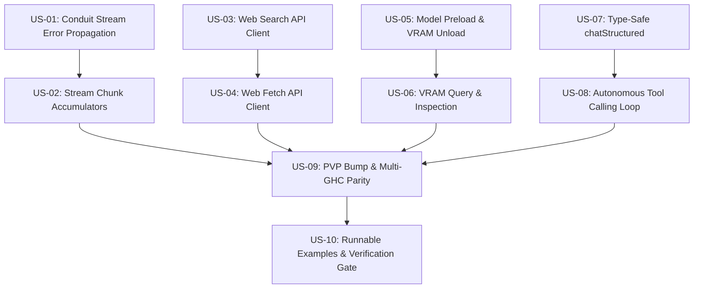

# `ollama-haskell` v0.4.3.0 — Product Roadmap & User Stories

> **Context**: This roadmap defines the strategic direction, architectural upgrades, and user stories for **`ollama-haskell` v0.4.3.0**, elevating the library from a robust low-level client to a production-grade, highly ergonomic toolkit for local and cloud-grounded LLM engineering in Haskell.
>
> It builds upon the stable foundations of **v0.4.2.0** (SystemOne decision API, ergonomic tool DSL, logprobs, and MCP server bridges) and addresses critical gaps against the latest Ollama engine developments (Ollama 0.4.x–0.6.x), official SDK standards (`ollama-python` v0.6.x, `ollama-js`), and competitive Rust/TypeScript counterparts.

---

## 1. Executive Summary & Competitive Analysis

### 1.1 Competitive Positioning Matrix

| Capability / API Domain | `ollama-python` (Official) | `ollama-js` (Official) | `ollama-rs` (Community Rust) | `ollama-haskell` (Current v0.4.2.0) | `ollama-haskell` (Target v0.4.3.0) |
| :--- | :--- | :--- | :--- | :--- | :--- |
| **Native Inference** (`/api/chat`, `/api/generate`) | ✅ Full | ✅ Full | ✅ Full | ✅ Full | ✅ Full |
| **Vector Embeddings** (`/api/embed` batching, truncate) | ✅ Full | ✅ Full | ✅ Full | ✅ Full | ✅ Full |
| **System Diagnostics** (`/api/ps`, `/api/version`, `/api/tags`, `/api/show`) | ✅ Full | ✅ Full | ✅ Full | ✅ Full | ✅ Full |
| **Web Grounding** (`/api/web_search`, `/api/web_fetch`) | ✅ `ollama.web_search` (v0.6+) | ⚠️ In progress | ❌ Missing | ❌ **Missing** | ✅ **EPIC B: Full typed support** |
| **Streaming Reliability & Error Propagation** | ✅ HTTP/JSON exception | ✅ Stream event error | ✅ Stream error | ⚠️ **Silent chunk drop on error** | ✅ **EPIC A: Typed stream error propagation** |
| **Stream Chunk Accumulators** | ⚠️ Manual loop | ⚠️ Manual loop | ⚠️ Manual loop | ⚠️ Manual fold | ✅ **EPIC A: First-class accumulators** |
| **Model VRAM Lifecycle** (`preloadModel`, `unloadModel`) | ⚠️ Manual `keep_alive=0` | ⚠️ Manual `keep_alive=0` | ⚠️ Manual | ⚠️ Manual | ✅ **EPIC C: Dedicated smart APIs** |
| **End-to-End Structured Output Decoding** | ✅ Pydantic model coercion | ✅ Zod validation | ⚠️ Serde derive | ⚠️ Manual `chat` + `eitherDecode` | ✅ **EPIC D: `chatStructured` with `ToSchema` + `FromJSON`** |
| **Autonomous Multi-Turn Tool Loop** | ⚠️ Manual loop | ⚠️ Manual loop | ⚠️ Manual loop | ⚠️ Manual multi-turn | ✅ **EPIC D: High-level `chatWithTools` runner** |
| **Model Context Protocol (MCP)** | ❌ External | ❌ External | ❌ External | ✅ `Ollama.MCP` (mcp-server >= 0.3) | ✅ Maintained & deepened |
| **System One Decision API** | ✅ Supported | ❌ Missing | ✅ Supported | ✅ Full support | ✅ Maintained |
| **Deterministic Mock Testing Suite** | ❌ None | ❌ None | ❌ None | ✅ Built-in `Ollama.Testing` | ✅ Maintained |

---

## 2. Key Insights from Latest Ollama API Research

1. **Ollama Cloud Web Grounding (`web_search` and `web_fetch`)**:
   - Ollama Cloud provides `POST https://ollama.com/api/web_search` and `POST https://ollama.com/api/web_fetch` authenticated via bearer token (`OLLAMA_API_KEY`).
   - Official `ollama-python >= 0.6.0` integrates this directly. Local reasoning models (e.g. DeepSeek-R1, Qwen 2.5) use search results as live tool inputs to eliminate hallucination.
2. **Streaming Error Ingestion**:
   - In Ollama NDJSON streams, if an error occurs mid-stream (context overflow, VRAM exhaustion, model crash), the server emits `{"error": "..."}` or closes with an HTTP 4xx/5xx payload. Swallowing decode errors hides runtime faults.
3. **GPU VRAM Optimization**:
   - Multi-agent pipelines frequently juggle vision models (e.g. `llama3.2-vision`), embedding models (`nomic-embed-text`), and reasoning models (`deepseek-r1`). Explicitly evicting models (`keep_alive: 0`) and warming them up before batch inference is essential for predictable latencies.
4. **Grammar-Constrained Structured Output Parity**:
   - Ollama natively enforces JSON Schema at the sampler level. Haskell's type system is uniquely positioned to offer compile-time schema derivation linked directly to runtime response parsing (`chatStructured @MyType`).

---

## 3. Dependency & Milestone Map



---

## 4. Release Strategy & Scope Tiers

| Tier | Epics / Stories | Rationale |
| :--- | :--- | :--- |
| **Tier 1: Core Reliability & Cloud Grounding (`P0`)** | **Epic A** (US-01, US-02), **Epic B** (US-03, US-04) | Fixes silent stream corruption, provides streaming accumulators, and introduces Ollama Cloud Web Grounding. |
| **Tier 2: High-Level Ergonomics & GPU Control (`P1`)** | **Epic C** (US-05, US-06), **Epic D** (US-07, US-08) | Provides explicit VRAM lifecycle management, end-to-end structured decoding, and an autonomous tool execution loop. |
| **Tier 3: Verification, Packaging & Documentation (`P0`)** | **Epic E** (US-09, US-10) | Ensures PVP compliance across GHC 9.4 through 9.12, formal spec verification gate passing, and comprehensive runnable examples. |

---

## 5. Epics & User Stories

### EPIC A — Streaming Reliability & Error Propagation (`P0`)

#### US-01: Explicit NDJSON Stream Error Detection & Exception Propagation
**Epic**: A — Streaming Reliability  
**Priority**: P0 (Bug fix / Reliability critical)  
**Target Modules**: `Ollama.Client.Internal`, `Ollama.Error`, `Ollama.Streaming`

**As a** backend engineer streaming token completions from Ollama,  
**I want** NDJSON parsing errors and server-side stream errors (`{"error": "..."}`) to immediately raise typed `OllamaError` values rather than being silently dropped,  
**So that** my application can cleanly recover, retry, or alert when the model server crashes, runs out of memory, or exceeds context limits mid-stream.

**Current Problem**:
In `src/Ollama/Client/Internal.hs`:
```haskell
parseAndYield = awaitForever $ \line -> do
  case eitherDecode (BSL.fromStrict line) of
    Left _err -> pure () -- SILENTLY IGNORED!
    Right val -> yield val
```
If Ollama returns `{"error": "model 'xyz' not found"}` or encounters mid-stream OOM, the line fails to decode as `ChatResponse` and is silently skipped, making the client believe the stream ended normally.

**Acceptance Criteria**:
- [ ] Define internal stream chunk discriminator `StreamLine a = StreamData a | StreamError Text | StreamParseError Text`.
- [ ] When a streamed line decodes to `{"error": msg}`, terminate the conduit pipeline by raising `ApiError 500 msg` or `StreamError msg`.
- [ ] When a line is neither valid JSON nor empty, emit `DecodeError` instead of swallowing it.
- [ ] Add unit test verifying that error payloads in streaming mode trigger `Left OllamaError` or throw the expected exception.

---

#### US-02: Stream Chunk Accumulators & Metrics Aggregation
**Epic**: A — Streaming Reliability  
**Priority**: P0  
**Target Modules**: `Ollama.Streaming`, `Ollama.API.Chat`, `Ollama.API.Generate`, `Ollama`

**As an** interactive terminal or UI developer,  
**I want** standard Conduit stream folding combinators (`accumulateChatStream`, `accumulateGenerateStream`) that return both the accumulated full `Message` (including thinking tokens and tool calls) and final timing metrics,  
**So that** I don't have to rewrite manual token and tool call accumulation loops in every consumer project.

**Acceptance Criteria**:
- [ ] Export `data AccumulatedChat = AccumulatedChat { accMessage :: !Message, accTotalDuration :: !(Maybe Duration), accEvalCount :: !(Maybe Int), accPromptEvalCount :: !(Maybe Int), accDoneReason :: !(Maybe Text) }` in `Ollama.Streaming`.
- [ ] Provide `accumulateChatStream :: (Monad m) => ConduitT () ChatResponse m () -> m (Either OllamaError AccumulatedChat)`.
- [ ] Safely concatenate streaming content chunks (`messageContent`), thinking traces (`messageThinking`), and assemble complete `ToolCall` objects.
- [ ] Provide corresponding `accumulateGenerateStream :: (Monad m) => ConduitT () GenerateResponse m () -> m (Either OllamaError GenerateResponse)`.
- [ ] Re-export all accumulators in `Ollama`.

---

### EPIC B — Cloud Grounding & Real-Time Web APIs (`P0`)

#### US-03: Web Search API Client (`POST https://ollama.com/api/web_search`)
**Epic**: B — Cloud Grounding  
**Priority**: P0 (Feature parity with `ollama-python >= 0.6.0`)  
**Target Modules**: `Ollama.API.WebSearch`, `Ollama.Types.Common`, `Ollama`

**As an** AI agent developer building RAG pipelines,  
**I want** a type-safe client endpoint for Ollama Cloud's Web Search API (`https://ollama.com/api/web_search`),  
**So that** my local models can search the public internet in real time using my Ollama account credentials.

**Specification**:
```haskell
-- Ollama.API.WebSearch
data WebSearchRequest = WebSearchRequest
  { wsrQuery :: !Text
  , wsrMaxResults :: !(Maybe Int)
  } deriving stock (Eq, Show, Generic)

data SearchResult = SearchResult
  { srTitle :: !Text
  , srUrl :: !Text
  , srContent :: !Text
  } deriving stock (Eq, Show, Generic)

newtype WebSearchResponse = WebSearchResponse
  { wsResults :: [SearchResult]
  } deriving stock (Eq, Show, Generic)

webSearch :: (MonadIO m) => OllamaClient -> WebSearchRequest -> m (Either OllamaError WebSearchResponse)
webSearchSimple :: (MonadIO m) => OllamaClient -> Text -> m (Either OllamaError [SearchResult])
```

**Acceptance Criteria**:
- [ ] Implement `WebSearchRequest`, `SearchResult`, and `WebSearchResponse` with strict `ToJSON` and `FromJSON` instances.
- [ ] Implement `webSearch` dispatching to `https://ollama.com/api/web_search` with bearer authentication (`configApiKey`).
- [ ] If `configApiKey` is absent, return `ConfigError "Ollama API key required for web search endpoint"`.
- [ ] Provide `webSearchTool :: Tool` so the web search API can be handed directly to Ollama models as a callable function.
- [ ] Add unit and mock tests in `test/Test/Ollama/Unit/WebSearch.hs`.

---

#### US-04: Web Fetch API Client (`POST https://ollama.com/api/web_fetch`)
**Epic**: B — Cloud Grounding  
**Priority**: P0  
**Target Modules**: `Ollama.API.WebSearch`, `Ollama`

**As an** agent developer inspecting search results,  
**I want** a type-safe client for Ollama Cloud's Web Fetch API (`https://ollama.com/api/web_fetch`),  
**So that** the model can pull and summarize the full markdown/text content of any URL retrieved from `webSearch`.

**Specification**:
```haskell
data WebFetchRequest = WebFetchRequest
  { wfrUrl :: !Text
  } deriving stock (Eq, Show, Generic)

data WebFetchResponse = WebFetchResponse
  { wfrTitle :: !Text
  , wfrContent :: !Text
  } deriving stock (Eq, Show, Generic)

webFetch :: (MonadIO m) => OllamaClient -> WebFetchRequest -> m (Either OllamaError WebFetchResponse)
webFetchSimple :: (MonadIO m) => OllamaClient -> Text -> m (Either OllamaError Text)
```

**Acceptance Criteria**:
- [ ] Implement `WebFetchRequest` and `WebFetchResponse` with JSON codecs.
- [ ] Implement `webFetch` dispatching to `https://ollama.com/api/web_fetch` with bearer authentication.
- [ ] Provide `webFetchTool :: Tool` for seamless autonomous agent integration.
- [ ] Re-export all functions in `Ollama`.

---

### EPIC C — Model Lifecycle & GPU VRAM Management (`P1`)

#### US-05: Dedicated Model Preloading & Instant VRAM Unloading
**Epic**: C — Model Lifecycle  
**Priority**: P1 (Production efficiency & multi-model systems)  
**Target Modules**: `Ollama.API.Models`, `Ollama`

**As a** system architect running multiple models on local GPU workstations,  
**I want** dedicated `unloadModel` and `preloadModel` convenience functions,  
**So that** I can explicitly free up VRAM when switching models and warm up heavy models before time-sensitive requests without writing boilerplate empty requests.

**Specification**:
```haskell
-- Ollama.API.Models
unloadModel :: (MonadIO m) => OllamaClient -> ModelName -> m (Either OllamaError ())
preloadModel :: (MonadIO m) => OllamaClient -> ModelName -> Maybe Duration -> m (Either OllamaError ())
```

**Acceptance Criteria**:
- [ ] `unloadModel client model` sends a `generate` request with an empty prompt and `keep_alive = Just "0"`, returning `Right ()` on success.
- [ ] `preloadModel client model mbKeepAlive` sends a `generate` request with an empty prompt and specified `keep_alive` duration (defaulting to `"5m"`).
- [ ] Both functions handle empty response payloads safely without throwing decode errors.
- [ ] Re-export in top-level `Ollama`.

---

#### US-06: Running Model Query & VRAM Metrics
**Epic**: C — Model Lifecycle  
**Priority**: P1  
**Target Modules**: `Ollama.API.Ps`, `Ollama`

**As a** DevOps engineer monitoring Ollama memory usage,  
**I want** helper functions `isModelRunning` and `getModelVramUsage`,  
**So that** my application can inspect whether a model is already resident in GPU memory before invoking it.

**Specification**:
```haskell
-- Ollama.API.Ps
isModelRunning :: (MonadIO m) => OllamaClient -> ModelName -> m (Either OllamaError Bool)
getModelVramUsage :: (MonadIO m) => OllamaClient -> ModelName -> m (Either OllamaError (Maybe Int64))
```

**Acceptance Criteria**:
- [ ] `isModelRunning` checks `/api/ps` and returns `True` if a matching `rmName` or `rmModel` is present.
- [ ] `getModelVramUsage` returns the `rmSizeVram` in bytes if the model is currently active in memory.
- [ ] Add unit tests verifying both helpers against mock `/api/ps` responses.

---

### EPIC D — End-to-End Structured Outputs & Agentic Tool Loop (`P1`)

#### US-07: Type-Safe `chatStructured` and `generateStructured`
**Epic**: D — Structured Outputs & Agents  
**Priority**: P1 (Haskell developer experience differentiator)  
**Target Modules**: `Ollama.API.Chat`, `Ollama.API.Generate`, `Ollama`

**As a** type-driven Haskell developer,  
**I want** high-level functions `chatStructured @a` and `generateStructured @a` that derive the JSON Schema via `ToSchema`, enforce it with Ollama, and automatically decode the assistant response into `a`,  
**So that** I get compile-time type safety with zero runtime deserialization boilerplate.

**Specification**:
```haskell
data StructuredResponse a = StructuredResponse
  { srValue :: !a
  , srRawResponse :: !ChatResponse
  } deriving stock (Eq, Show, Generic)

chatStructured ::
  forall a m.
  (MonadIO m, FromJSON a, ToSchema a) =>
  OllamaClient ->
  ChatRequest ->
  m (Either OllamaError (StructuredResponse a))

generateStructured ::
  forall a m.
  (MonadIO m, FromJSON a, ToSchema a) =>
  OllamaClient ->
  GenerateRequest ->
  m (Either OllamaError (a, GenerateResponse))
```

**Acceptance Criteria**:
- [ ] `chatStructured` sets `chatFormat = Just (formatFor @a)` and uses `eitherDecode` to parse `messageContent`.
- [ ] If JSON decoding fails, wrap the parse error into `OllamaError.DecodeError` with full raw content for debugging.
- [ ] Add comprehensive test suite verifying nested records, enum types, and list schemas.

---

#### US-08: Autonomous Multi-Turn Tool Execution Loop
**Epic**: D — Structured Outputs & Agents  
**Priority**: P1 (Agentic workflows)  
**Target Modules**: `Ollama.Conversation`, `Ollama.Types.Tool`, `Ollama`

**As an** agent developer,  
**I want** an autonomous tool calling loop (`chatWithTools`) that executes registered Haskell tool functions when the model requests tool calls, feeds the results back to the model, and repeats until a final text response is produced,  
**So that** I can build complete multi-step tool-calling agents in 10 lines of Haskell code.

**Specification**:
```haskell
data RegisteredTool m = RegisteredTool
  { rtTool :: !Tool
  , rtHandler :: !(Map Text Value -> m (Either Text Value))
  }

data ToolLoopConfig = ToolLoopConfig
  { tlcMaxTurns :: !Int  -- e.g. default 10
  , tlcOnTurn :: !(Maybe (Int -> Message -> IO ()))
  }

chatWithTools ::
  (MonadIO m) =>
  OllamaClient ->
  ChatRequest ->
  [RegisteredTool m] ->
  ToolLoopConfig ->
  m (Either OllamaError (Message, [Message]))
```

**Acceptance Criteria**:
- [ ] Handle multiple parallel tool calls emitted in a single assistant turn.
- [ ] Correlate tool outputs via `toolResultMessageWithId` using `tcId`.
- [ ] Enforce recursion limits via `tlcMaxTurns` to prevent infinite loops.
- [ ] Provide example application `examples/AutonomousAgent.hs` demonstrating a live calculator / weather tool loop.

---

### EPIC E — Monorepo Alignment, Quality Gate & Documentation (`P0`)

#### US-09: PVP Version Bump to `0.4.3.0`, Multi-GHC Parity & Cabal Check
**Epic**: E — Release Quality  
**Priority**: P0 (Release Blocker)  
**Target Files**: `ollama-haskell.cabal`, `CHANGELOG.md`, `README.md`, stack configs

**As a** Hackage package maintainer,  
**I want** `ollama-haskell.cabal` bumped to `0.4.3.0` with strict PVP-compliant dependency bounds and successful builds across GHC 9.4 through 9.12,  
**So that** the package publishes cleanly to Hackage with zero warnings.

**Acceptance Criteria**:
- [ ] `ollama-haskell.cabal` version set to `0.4.3.0`.
- [ ] `CHANGELOG.md` updated with comprehensive `## [0.4.3.0]` release notes following Keep a Changelog.
- [ ] `cabal check` passes with zero errors or warnings.
- [ ] Stack configuration files (`stack.yaml`, `stack-lts-*.yaml`, `stack-nightly.yaml`) compile cleanly under `--pedantic`.

---

#### US-10: Runnable Examples, Formal Spec Verification & Hakyll Docs Update
**Epic**: E — Release Quality  
**Priority**: P0  
**Target Files**: `examples/`, `docs/`, `test/`, `AGENTS.md`

**As a** developer learning `ollama-haskell`,  
**I want** runnable examples for all new capabilities (WebSearch, VRAM Lifecycle, `chatStructured`, and `chatWithTools`) and documentation tutorials updated on the Hakyll site,  
**So that** every public API has verified copy-pasteable code.

**Acceptance Criteria**:
- [ ] Add `examples/WebSearch.hs` demonstrating `webSearch` and `webFetch`.
- [ ] Add `examples/StructuredDerive.hs` demonstrating `chatStructured`.
- [ ] Add `examples/VramLifecycle.hs` demonstrating `preloadModel` and `unloadModel`.
- [ ] Run `./.agents/skills/formal-spec-verifier/scripts/verify_gate.sh --haskell` with 100% green exit code.
- [ ] Format all Haskell files with `fourmolu` and verify `hlint` cleanliness.

---

## 6. Release Checklist & Rollout Strategy

1. **Phase 1: Epic A & B Implementation (Core Plumbing & Cloud Grounding)**:
   - Fix NDJSON stream error handling (`US-01`)
   - Add stream accumulators (`US-02`)
   - Add `Ollama.API.WebSearch` (`US-03`, `US-04`)
2. **Phase 2: Epic C & D Implementation (Ergonomics & Agents)**:
   - Implement `preloadModel` & `unloadModel` (`US-05`, `US-06`)
   - Implement `chatStructured` & `generateStructured` (`US-07`)
   - Implement autonomous tool calling loop (`US-08`)
3. **Phase 3: Epic E Verification Gate & Hackage Release**:
   - Write golden and property tests for all new endpoints
   - Run `verify_gate.sh --haskell`
   - Run `make format-check && make lint`
   - Validate `cabal check`
   - Tag release `v0.4.3.0` on `develop` and prepare PR for release stabilization.

